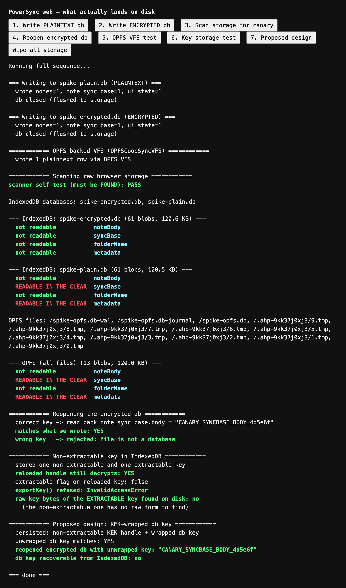

# Web at-rest encryption — spike findings

**Branch:** `spike/powersync-web-at-rest` · **Date:** 2026-08-21 · **Status:** investigation complete

**Verdict: GO**, with one correction to the premise this spike was commissioned on.

The brief assumed that "what does NOT port is the SQLCipher whole-file layer:
`@powersync/web` uses wa-sqlite/WASM, which has no SQLCipher equivalent."
**That is no longer true.** `@powersync/web` ships whole-file encryption today,
and this spike proved it working. The interesting question turned out not to be
*"how much do we lose?"* but *"where does the remaining, much smaller gap sit?"*

---

## 1. What `@powersync/web` persists, and where

Both OPFS and IndexedDB, selected by a `vfs` option. This is a real choice, not
an implementation detail — it decides which storage bucket your notes live in.

| VFS | Backing store | Notes |
|---|---|---|
| `IDBBatchAtomicVFS` | **IndexedDB** | The default. Broadest compatibility, works without a worker. |
| `OPFSCoopSyncVFS` | **OPFS** | Recommended for multi-tab, incl. Safari/iOS. Requires a worker. |
| `AccessHandlePoolVFS` | OPFS | Single-tab. |
| `OPFSWriteAheadVFS` | OPFS | WAL, parallel reads, Chromium only. |
| `InMemoryVFS` | nothing | No persistence. Dev/online-only. |

SQLite is a *file* format, so under IndexedDB the database is not stored as
rows-you-can-read — it is stored as **SQLite pages**, chunked into an object
store called `blocks`, each record shaped `{path, offset, version, data}` with
`data` a `Uint8Array`. Under OPFS it is an actual file (`spike-opfs.db`) plus
`-wal` / `-journal` companions and a pool of `.tmp` access handles.

**What that means after the tab closes:** it stays. Both are persistent
origin-scoped storage that survives tab close, browser restart, and reboot.
Neither is protected by the OS user account in the way an app sandbox is — any
process running as that user can read the browser profile directory. Clearing
site data or browser "clear browsing data" wipes it; **eviction under storage
pressure can too, unless you call `navigator.storage.persist()`** (worth doing
for an offline-first PWA regardless of encryption).

Verified empirically — both stores enumerated and dumped, see §6.

## 2. Whole-file encryption on wa-sqlite: **yes, and it is production-ready**

`@powersync/web` supports an `encryptionKey` option, implemented with
[**SQLite3MultipleCiphers**](https://utelle.github.io/SQLite3MultipleCiphers/)
(SQLite3MC) — a well-established SQLite encryption extension, compiled to WASM.
**ChaCha20** is the default cipher. This is page-level encryption of the whole
database file, i.e. the same *class* of protection SQLCipher gives us natively,
not a field-level workaround.

Crucially for us, this is not a download-a-blob-yourself affair on the JS side.
The ciphers builds ship **inside the npm package**:

```
node_modules/@journeyapps/wa-sqlite/dist/
  mc-wa-sqlite.wasm         1.3 MB
  mc-wa-sqlite-async.wasm   2.5 MB
  mc-wa-sqlite-jspi.wasm    1.3 MB
```

`@powersync/web` picks the `mc-` build automatically when an `encryptionKey` is
present (`lib/db/adapters/wa-sqlite/vfs.js`), then applies the key with
`PRAGMA key = '...'` (`RawSqliteConnection.js:38`). Nothing to vendor, no
manual `.wasm` copying. (The `dart run powersync:setup_web --encryption` step in
PowerSync's docs is the **Flutter** flow — it does not apply to us. This is the
kind of thing that makes docs look like a dead end when they aren't.)

**Honest caveats.** ~1.3–2.5 MB of WASM is a real cost for a *web* bundle in a
way it isn't natively; it is cached after first load but the first visit pays
it. And SQLite3MC in a browser has less field-mileage than SQLCipher on mobile
— it is genuine encryption, not theatre, but it is a younger deployment story.

## 3. Threat model — and why `note_sync_base` is the finding that matters

The brief asked what the picture looks like with *only* the existing AES-GCM
field encryption. Answering that precisely is what makes the case for turning
whole-file encryption on, so here is the measured counterfactual.

I mirrored the real schema — content encrypted at the app layer,
`note_sync_base.body` written as plaintext, ids/timestamps clear — into an
**unencrypted** PowerSync web database, then read the raw bytes back out:

| Data | In an unencrypted web db | Why |
|---|---|---|
| Note body | **not readable** | AES-GCM at the app layer. Ports to web unchanged. |
| Folder name (Stage 10) | **not readable** | Same. |
| `note_sync_base.body` | **READABLE IN THE CLEAR** | Stored as plaintext *by design*. |
| Note ids, timestamps, trash state | **READABLE IN THE CLEAR** | Never encrypted; sync/RLS filter on them. |
| Folder *structure* (`parent_id`, `depth`, `sort_order`, `kind`) | **READABLE IN THE CLEAR** | Plaintext by design — the server orders and filters on it. Names are encrypted, the shape of the tree is not. |
| `api_endpoints.url`, `plaintext_disclosures` | **READABLE IN THE CLEAR** | `localOnly` tables; URLs you approved and a log of note ids whose plaintext left the device. |

**The headline is not the metadata — it is `note_sync_base`.** That table holds
the last body the server was known to have, in plaintext, for *every note you
have edited*. `lib/powersync/schema.ts` says so explicitly and justifies it in
so many words:

> It is safe only because the entire local database file is encrypted at rest
> by SQLCipher, so "plaintext" here means plaintext inside an encrypted
> container.

Ship web on field-encryption alone and that sentence silently becomes false.
This would not be a metadata downgrade, it would be **full note plaintext
sitting in browser storage** — not a subtle erosion of the guarantee but a
hole straight through it. The 3-way merge needs a diffable ancestor, so it
cannot simply be encrypted without redesigning `mergeBody.ts`.

That is why "field encryption is probably good enough for web" is the wrong
answer, and why the encrypted path below is not optional polish.

**With SQLite3MC enabled, all four canaries come back unreadable** — the
container is opaque, exactly as on native.

### What remains different from native, with encryption on

Being precise about the residual gap, since this is what gets documented:

1. **No hardware-backed key store.** Native wraps keys with a key in the iOS
   Keychain / Android Keystore. The browser has no equivalent. This is the real
   delta and §4 covers it.
2. **No user-presence gate.** Native can require Face ID before unlocking. A web
   session key usable without interaction is, by construction, usable by
   anything running in that origin.
3. **XSS is a key-compromise vector.** Native has no analogous "attacker runs
   script inside your app" surface. Whole-file encryption does nothing against
   it: script in the origin can just ask the open database. **Encryption at rest
   protects the disk, not the running page.** A strict CSP matters as much as
   the cipher here.
4. **Eviction/backup semantics differ** — browser storage can be cleared by the
   browser; app data is backed up by the OS.

Quantified: with encryption on, a **stolen-disk / another-user-on-the-same-machine**
attacker gets the same answer as native — nothing. A **compromised-origin**
attacker (XSS, malicious extension) gets everything, which native largely does
not expose. The downgrade is real but it is *narrower and differently shaped*
than "web can't do at-rest".

## 4. Key storage in the browser

The constraint that shapes everything: **`encryptionKey` is a `string`**,
because it becomes `PRAGMA key = '...'`. There is no way to hand wa-sqlite an
opaque key handle. So the key material *must* exist as a JS string at open time,
and "non-extractable CryptoKey" cannot be the database key itself. It can only
be the **key-encrypting key (KEK)** that wraps it.

| Option | Raw key recoverable from disk? | UX cost per session |
|---|---|---|
| Raw key in IndexedDB/localStorage | **Yes** — trivially | none |
| **Non-extractable CryptoKey as KEK, wrapped db key in IndexedDB** | **No** | none |
| WebAuthn PRF (passkey-derived) | No | a passkey gesture per session |
| Passphrase-derived, memory only | No | typing a passphrase per session |

**Recommended: the KEK approach**, proven working in §6. Generate an AES-GCM KEK
with `extractable: false`, persist the *handle* in IndexedDB (structured-clone
keeps it across reloads), wrap the database key under it, and unwrap per session.
On disk that leaves only a wrapped blob and a handle whose bytes script cannot
read; `exportKey()` throws `InvalidAccessError`.

**The honest limit, which I want to state precisely because it is easy to
oversell:** non-extractable means *script cannot read the bytes*. It does **not**
mean the browser lacks them, and it is not hardware-backed the way a Keychain
item is. Any code running in the origin can still *use* the key to unwrap and
open the database. It defeats disk inspection and key exfiltration; it does not
defeat XSS. (My own test also shows even the *extractable* key's raw bytes were
not sitting in the IndexedDB value payload — Chrome keeps key material in its
own store — so the meaningful distinction is script-level, not disk-level.)

**The closest honest web equivalent to native biometric unlock is WebAuthn PRF**:
the user authenticates with a passkey (Face ID / Touch ID / Windows Hello) and
the authenticator returns a 32-byte secret used to derive the key. That gives a
genuine user-presence gate and hardware-backed material. Support in 2026 is good
(Chrome/Edge/Samsung on Android, Safari 18+ with iCloud Keychain) but **not
universal**, so it cannot be the only path. Note the standard objection — a lost
authenticator means lost data — **which this app is already immune to**, because
the 12-word recovery code is an independent path to the data key. That makes PRF
a much safer bet for us than for most apps.

**Recommended shape:** KEK-wrapped key as the baseline (works everywhere, zero
friction), with PRF as an *optional* "require Face ID to open notes on this
device" upgrade later. Do not build PRF for v1.

## 5. Can `lib/crypto/` and `VaultContext` be shared? Mostly yes — the split is small

The existing split is already almost exactly right, because `keys.ts` was
deliberately kept free of Expo/RN imports so `scripts/verify-crypto.ts` could
run it under Node. That discipline pays off here.

**Ports unchanged (zero platform imports):** `keys.ts`, `envelope.ts`,
`noteCrypto.ts`, `base64.ts`, `wordlist.ts`, `adoption.ts`, `keySetup.ts` —
the entire cryptographic core. It is `@noble/*` only, which is pure JS and runs
in a browser as-is.

**Needs a platform split — three files, and only two are real work:**

| File | Coupling | Work |
|---|---|---|
| `lib/crypto/vault.ts` | `expo-secure-store`, `react-native-get-random-values` | **The real one.** Needs a storage backend behind an interface: SecureStore natively, KEK-wrapped IndexedDB on web. The polyfill import just drops (browsers have `crypto.getRandomValues`). |
| `contexts/VaultContext.tsx` | `react-native` `AppState`, `deviceAuth` | Moderate. `AppState` → `visibilitychange`; `authenticateWithDeviceCredential` → a no-op or PRF on web. |
| `lib/auth/deviceAuth.ts` | `expo-local-authentication` | Small. Needs a web implementation returning `'unavailable'`, which the existing `LockCapability`/`AuthOutcome` types already model. |

`keyBackup.ts` (imports `supabase`) and `reEncrypt.ts` (imports `getPowerSync`)
are **not** platform-coupled — those deps have web equivalents already.

**Estimate: one focused stage.** The shape is "extract a `VaultStorage`
interface with two implementations", not a rewrite. The key model itself —
dataKey / dbSeed / deviceKey, recovery-code wrapping, `user_keys` adoption —
carries over conceptually intact, with `deviceKey` becoming the non-extractable
KEK.

Note `expo-secure-store` is used in six other places (`supabase/client.ts`,
`connector.ts`, `endpoints.ts`, `ThemeContext.tsx`, `serializeAuthWork.ts`).
Those are outside the crypto core but they *will* surface in a web build; worth
knowing before the UI stage rather than during it.

## 6. Proof

Standalone spike in [`spike/web-at-rest/`](../spike/web-at-rest/) — real
`@powersync/web` 2.2.0 in a real Chrome, rows written, closed, reloaded, then
raw storage dumped and searched for canary strings.

Reproduce:

```bash
cd spike/web-at-rest && npm install && npx vite & sleep 3 && node capture.mjs
```



Full transcript: [`evidence/at-rest-scan.txt`](../spike/web-at-rest/evidence/at-rest-scan.txt).

```
--- IndexedDB: spike-encrypted.db (61 blobs, 120.6 KB) ---
  not readable           noteBody
  not readable           syncBase
  not readable           folderName
  not readable           metadata

--- IndexedDB: spike-plain.db (61 blobs, 120.5 KB) ---
  not readable           noteBody
  READABLE IN THE CLEAR  syncBase
  not readable           folderName
  READABLE IN THE CLEAR  metadata

--- OPFS (all files) (13 blobs, 120.0 KB) ---
  not readable           noteBody
  READABLE IN THE CLEAR  syncBase
  not readable           folderName
  READABLE IN THE CLEAR  metadata
```

Controls, because "unreadable" on its own is a weak claim — random bytes would
score identically:

```
============ Reopening the encrypted db ============
  correct key -> read back note_sync_base.body = "CANARY_SYNCBASE_BODY_4d5e6f"
  matches what we wrote: YES
  wrong key   -> rejected: file is not a database

============ Proposed design: KEK-wrapped db key ============
  persisted: non-extractable KEK handle + wrapped db key
  unwrapped db key matches: YES
  reopened encrypted db with unwrapped key: "CANARY_SYNCBASE_BODY_4d5e6f"
  db key recoverable from IndexedDB: no

============ Non-extractable key in IndexedDB ============
  reloaded handle still decrypts: YES
  extractable flag on reloaded key: false
  exportKey() refused: InvalidAccessError
```

So: the encrypted database is genuinely encrypted (wrong key rejected), genuinely
persistent (survives reload), genuinely decryptable (exact plaintext back), and
the key that opens it is not recoverable from storage.

The scan also carries a **self-test** that asserts the scanner can find a string
that really is in the clear. That is not ceremony — my first version of the
scanner silently reported "all safe" for the *plaintext* database, because
IndexedDB stores pages as `Uint8Array` and my `instanceof ArrayBuffer` check fell
through to `JSON.stringify`. A false negative in the reassuring direction is the
worst possible bug in a spike like this, so the check now fails loudly instead.

## 7. PWA vs Trusted Web Activity

**Recommendation: PWA yes, TWA no.**

TWA is Android packaging around a PWA — a Play Store listing that launches your
site fullscreen in Chrome. It is a distribution path, not an architecture, so it
only ever competes with the *existing native Android app*, which already exists,
already ships, and has the **stronger** at-rest story (hardware-backed Keystore,
SQLCipher, OS biometrics). Shipping a TWA would mean two Android artifacts with
different security properties and a confusing Play Store presence, in exchange
for nothing users can't already get.

Ship the PWA as an installable, offline-capable web app — that is the genuinely
additive part, reaching desktop and iOS-without-the-App-Store. Revisit TWA only
if the native Android app is ever retired.

## GO / NO-GO

**GO** — proceed to web UI work, conditional on the encryption path below being
what actually ships. The blocking technical unknown this spike existed to
resolve is resolved: web can hold its own at rest.

Required for the web build (not optional):

1. **`encryptionKey` set, always.** An unencrypted web database puts
   `note_sync_base` plaintext on disk. Treat a missing key as a hard failure at
   open time — mirror the existing native discipline where `getDatabaseKey()`
   throwing is *preferred* over opening unencrypted.
2. **KEK-wrapped database key** (§4). Never persist the raw key.
3. **Strict CSP.** With at-rest solved, XSS is the top residual risk.
4. **`navigator.storage.persist()`**, so an offline-first app isn't silently evicted.
5. Pick the VFS deliberately — `OPFSCoopSyncVFS` for multi-tab/Safari, else the
   IndexedDB default. Both were verified equivalent for encryption.

### Plain-language guarantee, if we ship this

Proposed wording, to sit alongside the native E2EE description — **needs your
sign-off before it goes in `docs/roadmap.md` / `NOTES.md`**, per the escalation
rule:

> **On the web, your notes are encrypted on your device.** Note text and folder
> names are encrypted before they ever leave your browser, and the local
> database itself is fully encrypted too — so someone with access to your
> computer's files cannot read your notes without the key. The key is stored so
> that no website script, including ours, can read it out.
>
> **What's different from the phone app.** Phones can lock the key in dedicated
> security hardware and require Face ID or a passcode to unlock it. Browsers
> have no equivalent, so on the web your notes open without a separate unlock
> step. That also means the protection is against someone reading your files —
> not against someone who can run code inside your browser session. For the
> strongest protection, use the phone app.

### Open questions for you

- **The guarantee wording above** — it changes the public security story, so
  it's yours to approve, edit, or reject.
- **Bundle size:** +1.3–2.5 MB WASM. Acceptable for an installable PWA, but it
  is a visible first-load cost and worth an explicit yes.
- **Web adds `@powersync/web` to the main app.** A new dependency on the main
  app needs your call before any UI stage starts.
- **Does the web build need a lock screen at all?** Native has `LockSettings`.
  Without PRF there is nothing real behind a web lock screen — it would be
  decorative. My recommendation is to omit it rather than imply protection that
  isn't there, but it's a product call.

---

# Addendum — re-verified on the app's own pipeline (2026-08-25)

The findings above were produced on 2026-08-21 in a **standalone Vite project
running `@powersync/web` 2.2.0**. The app itself is on **2.1.0**, bundles
through **Metro**, and loads a **pre-bundled worker committed under
`public/@powersync/`** — none of which was in that spike's path. This project
has already been bitten once by exactly that gap: running wa-sqlite in the tab
works fine under Vite and dies under Metro on `import.meta`. So the conclusion
needed re-proving where it will actually live.

**It holds.** Everything below was run against the real app on this branch.

## What was re-confirmed on 2.1.0

`encryptionKey` is present in `db/adapters/options.d.ts`, and
`db/adapters/wa-sqlite/vfs.js` still auto-imports the `mc-` (SQLite3MultipleCiphers)
build when a key is set. No behaviour was added between 2.1.0 and 2.2.0 that the
recommendation depends on — **the pin does not have to move.** That matters,
because moving it would drag `@powersync/common` up under the native SDK's feet,
which is the reason it is pinned in the first place.

## The evidence, through Metro and our committed worker

A throwaway route opened a second PowerSync database beside the app's own —
`OPFSCoopSyncVFS`, `worker: '/@powersync/worker.js'` — once with an
`encryptionKey` and once without, wrote a canary string, and the page was then
reloaded. Raw OPFS bytes, read back through
`navigator.storage.getDirectory()`:

| File | First 15 bytes | Canary in the clear? |
|---|---|---|
| `spike-plain.db` (102,400 B) | `SQLite format 3` | **YES** |
| `spike-enc.db` (102,400 B) | `\0` × 15 | no |

Controls, because "unreadable" alone proves nothing:

- **Wrong key → `file is not a database`.** The cipher is load-bearing, not decorative.
- **Both databases survived a full page reload** with the row intact, so this is
  real persistence and not a memory artefact.
- The plaintext file carries the SQLite magic header; the encrypted one does not
  — page 1 is encrypted too, which is what distinguishes whole-file encryption
  from encrypting only the payload.

`navigator.storage.persisted()` returned **`false`**, confirming §1's warning
first-hand: without an explicit `navigator.storage.persist()` call this storage
is evictable, which for an offline-first PWA is a data-loss path independent of
encryption.

## Two things the original spike could not have seen

**1. Our asset pipeline currently deletes the ciphers WASM.**
`package.json`'s `powersync:assets` script is:

```
powersync-web copy-assets && find public/@powersync -name '*.map' -delete
  && find public/@powersync/assets -name 'mc-*' -delete -o -name '*-async-*' -delete
```

That prune was correct for the memory-only build 12g shipped — it took the
committed payload down to a single 1.1 MB `wa-sqlite.wasm`. But `mc-*` **is**
the encryption build. As committed today, **the app physically cannot open an
encrypted database**, regardless of what the code asks for. Turning encryption
on is not only a code change; the prune has to change and the larger `.wasm`
has to be committed (or generated at install time instead).

**2. The VFS choice halves the WASM cost, and the cheaper one is also the better one.**
`vfs.js` routes **only `IDBBatchAtomicVFS`** through the async module factory;
every OPFS VFS and `InMemoryVfs` use the sync one. So:

| Choice | WASM to ship | Multi-tab / Safari |
|---|---|---|
| `IDBBatchAtomicVFS` + encryption | `mc-wa-sqlite-async.wasm` — **2.50 MB** | weaker |
| `OPFSCoopSyncVFS` + encryption | `mc-wa-sqlite.wasm` — **1.31 MB** | the SDK's own recommendation |

This sharpens §1's "pick the VFS deliberately" into a straight answer:
**`OPFSCoopSyncVFS`**, which is better on both axes at once. It also revises the
bundle-cost question put to Adam below — the honest number is **+1.31 MB over
today's 1.12 MB, i.e. ~+0.2 MB net** if the plain build is dropped in favour of
the ciphers build, not the "+1.3–2.5 MB" the original write-up estimated.
Verified above running on exactly that VFS.

## Status of the four open questions

| Question | Now |
|---|---|
| Guarantee wording | **Still Adam's.** Unchanged, still needs sign-off. |
| Bundle size | Better than estimated — **~+0.2 MB net**, see above. Still Adam's yes. |
| Adding `@powersync/web` to the main app | **Closed.** 12g added it (pinned 2.1.0) with Adam's approval. |
| Does web need a lock screen? | **Still Adam's.** Product call, unchanged. |

## What this does not change

The recommendation, the threat model, and the `note_sync_base` finding all
stand — that last one is still the reason encryption is mandatory rather than
nice-to-have, and nothing here softens it. The GO stands, on the same five
conditions.
